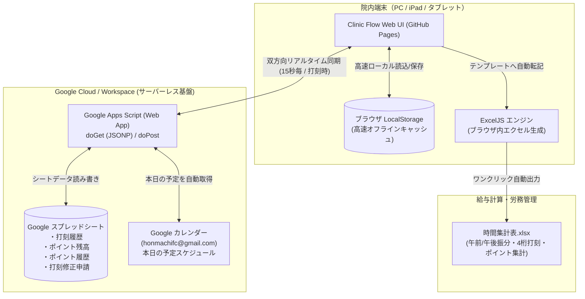
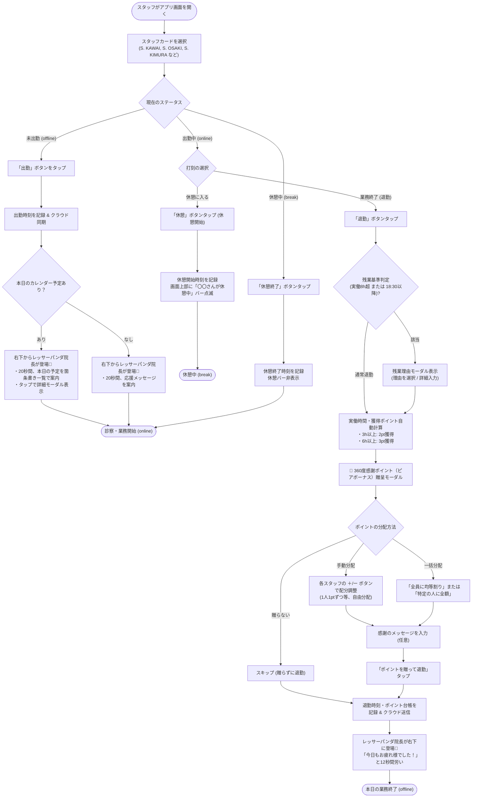
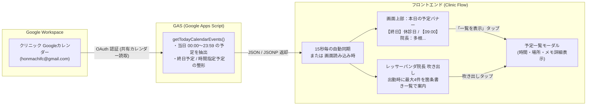
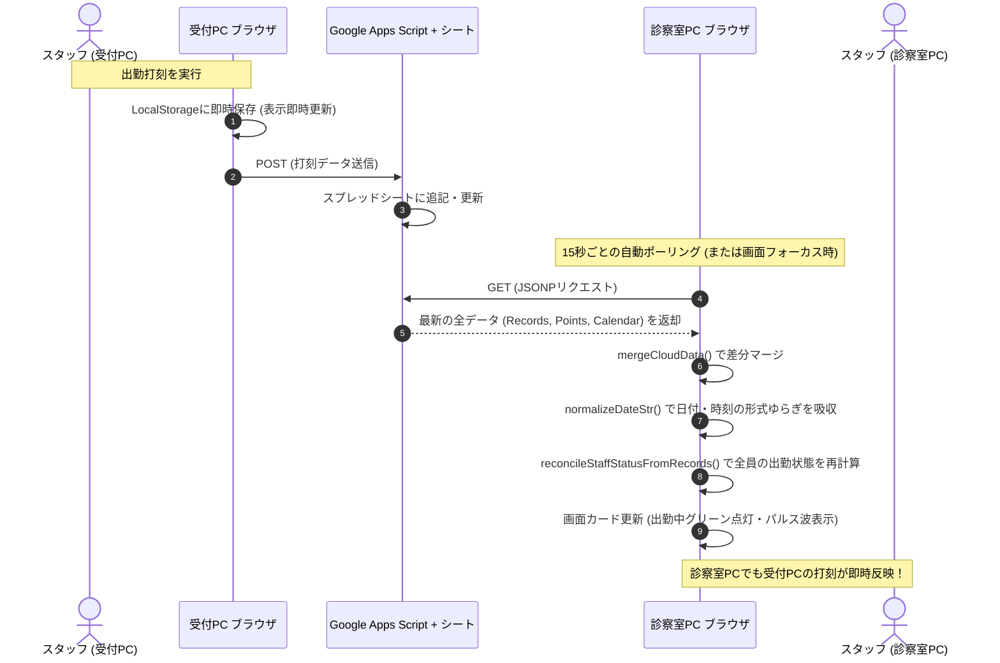
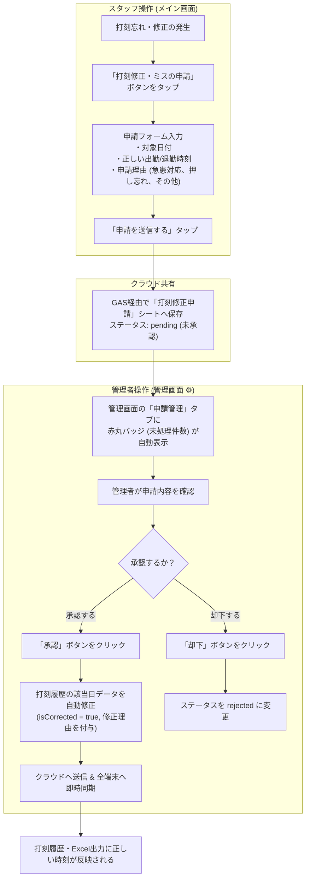
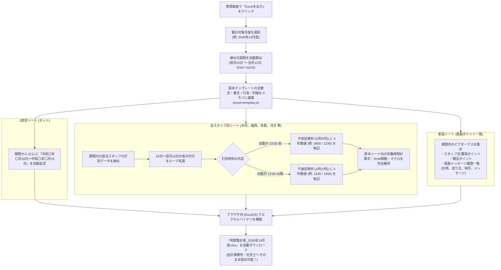

# Clinic Flow - システム全体フローチャート＆設計仕様書

本ドキュメントは、クリニック向け出勤・360度評価ポイント管理システム **「Clinic Flow」** の全体構造、業務フロー、データ連携、内部ロジックを網羅した包括的なフローチャート集です。

---

## 1. システム全体アーキテクチャ（全体構成図）

Clinic Flow は、月額サーバー費用ゼロ（完全サーバーレス）でありながら、院内複数端末（PC・タブレット）でのリアルタイム同期、Googleカレンダー連携、および給与計算用Excel自動生成を実現しています。

---

## 2. スタッフの日次業務フロー（出勤・休憩・退勤・ピアボーナス）

スタッフが1日の中で行う打刻・操作のメインフローです。

---

## 3. Googleカレンダー連携＆予定アナウンスフロー

クリニックのGoogleカレンダー（`honmachifc@gmail.com`）から本日の予定を読み取り、画面上部および出勤時のマスコットに反映する仕組みです。

---

## 4. 複数端末（マルチPC・iPad）リアルタイム同期フロー

院内の受付PC、診察室PC、スタッフルームのiPadなどで同時に打刻が行われても、データの衝突や不整合を起こさずに瞬時に状態を同期するアーキテクチャです。

---

## 5. 打刻ミス・漏れの修正申請＆承認ワークフロー

打刻忘れや急患対応による打刻遅れを、紙メモを使わずにアプリ上で完結させるワークフローです。

---

## 6. 給与計算用エクセル（時間集計表）ワンクリック自動出力フロー

月末の給与計算業務をゼロにするため、原本エクセルファイル（`R8.10法人後　時間集計表.xlsx`）の構造をブラウザ内で完全に再現し、打刻データを自動転記して出力するフローです。

---

## 7. まとめ（機能と仕様の対応一覧表）

| 領域 | 主要機能 | 動作のポイント |
| :--- | :--- | :--- |
| **打刻・勤怠** | 出勤・休憩・退勤 | 1画面で迷わないカード選択。休憩中は上部バーが点滅。残業時は理由入力必須化。 |
| **スケジュール** | Googleカレンダー連携 | `honmachifc@gmail.com` から当日の全予定を自動読取。上部バナー＆モーダル一覧表示。 |
| **遊び心・演出** | レッサーパンダ院長 | 出勤時に画面右下に登場。20秒間滞在し、本日の予定を箇条書きで案内（×で即閉じ可）。 |
| **評価・文化** | 360度ピアボーナス | 実働時間に応じて原資ポイント獲得。退勤時に同僚へ感謝メッセージとともに自由配分。 |
| **同期・インフラ** | 複数端末リアルタイム同期 | サーバー契約不要（GAS + Sheets）。JSONPによる双方向同期で他端末の打刻も即座に反映。 |
| **労務・修正** | 打刻ミス修正申請 | スタッフがスマホ・PCから修正申請 → 管理者がワンクリックで承認 → データ即時反映。 |
| **給与計算** | Excelワンクリック出力 | 16日〜翌15日判定、午前・午後診察の自動振り分け、4桁時刻入力、ポイント集計シート同梱。 |

